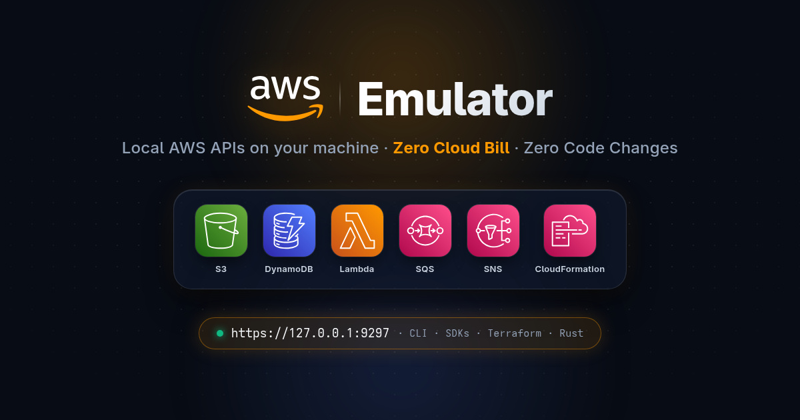

+++
title = "AWS Finally Built an Official Local Emulator (And AI Agents Update It All Day)"
date = 2026-11-15
[taxonomies]
tags = ["aws", "devops", "terraform", "testing"]

[extra]
mermaid = true
+++

# AWS Finally Built an Official Local Emulator (And AI Agents Update It All Day)



Let’s be honest for a second: testing AWS code locally has always been a little bit of a chore.

You’re building a feature that uploads a file to S3 and writes a row to DynamoDB. Simple enough, right? Except now you want to run your tests. At this point, you usually have three choices, and none of them feel great:

1. **Test against a real AWS dev account.** Works great until your CI pipeline fails because of an expired token, two developers step on the same staging table, or someone forgets to tear down a test stack over the weekend.
2. **Mock the SDK in your code.** You write 80 lines of mock stubs, your tests pass in 4 milliseconds, you feel like a genius, and then production crashes because you passed a two-character table name or forgot a required field that your mock happily ignored.
3. **Frankenstein a local Docker setup together.** You spin up DynamoDB Local on port `8000`, MinIO on port `9000`, maybe LocalStack on `4566`, and suddenly your app code is littered with `if (process.env.IS_LOCAL)` hacks just to route traffic to the right port.

Well, AWS just dropped something really interesting to fix this: **[AWS Emulator](https://docs.aws.amazon.com/emulator/latest/userguide/what-is-service.html)**.

It’s an official, free, open-source local emulator for AWS APIs that runs right on your machine. No AWS account needed. No internet connection needed for your tests. And no changing your application code.

I spent some time digging through how it works, testing out the workflows, and seeing where it shines (and where it doesn't yet). Here’s the human-friendly breakdown.

## Wait, AI Agents Maintain It?

Before we even touch a terminal, there are three things about AWS Emulator that genuinely surprised me:

- **It’s in the public domain (CC0 1.0).** AWS didn't put this behind a proprietary binary or a "Community vs. Pro" paywall. The core source code on [GitHub (`aws/aws-emulator`)](https://github.com/aws/aws-emulator) is CC0 1.0 Universal.
- **AI agents keep it updated multiple times a day.** The biggest problem with cloud emulators is that AWS ships new API changes constantly, so emulators are always playing catch-up. AWS actually uses AI agents to continuously update the emulator and verify its responses against real AWS (`us-west-2` and `us-east-1`) several times a day.
- **It comes with a skill for *your* AI coding agent.** If you use Claude Code, Cursor, Kiro, or Copilot, there’s an official `aws-emulator` skill. You can literally tell your agent: *"Install AWS Emulator, hook up my project, and tell me if all the AWS APIs I'm using are supported."*

## How It Actually Feels to Use

Instead of giving you a dashboard or a heavy multi-gigabyte VM, `aws-emulator` is just a fast command-line server. When it’s sitting idle, it uses about **160 MB of RAM**.

If you’re on Linux, you can install the native `.deb` or `.rpm` package in a couple of seconds:

```bash
curl -fsSLo aws-emulator.deb https://downloads.aws.com/aws-emulator/packages/aws-emulator/LTS/latest/aws-emulator_amd64.deb
sudo apt-get install -y ./aws-emulator.deb
```

*(On a Mac or Windows? You don't get left out. There is a tiny 8-line `Dockerfile` based on Amazon Linux 2023 Minimal that runs it in a container).*

Or, if you're lazy like me and have AWS CLI `v2.35.0+`, you can just give the skill to your AI coding agent and let it do the setup for you:

```bash
aws agent-toolkit add-skill --skill-name aws-emulator --region us-east-1
```

### Starting It Up

You open a terminal and run:

```bash
aws-emulator
```

That’s it. It starts listening on `https://127.0.0.1:9297`.

Behind the scenes, it does something pretty clever. Every single time you start it, it creates a folder at `~/.aws/emulator/9297/` and generates:
- A fresh set of temporary AWS credentials (`EMULATOR...`) that only work for this single run.
- A local TLS certificate (`ca.pem` and a Java `truststore.p12`) so everything runs over real HTTPS.
- A ready-to-go AWS `config` file.

Why does that matter? Because your SDK still has to sign requests with **SigV4** over **HTTPS**, just like it does in production. And if you accidentally try to send requests signed with your *real* production AWS keys, the emulator rejects them immediately.

## Zero Code Changes: Pointing Your App at the Emulator

Here is my favorite part. You don’t have to touch your application code to use it. You just export a handful of environment variables in the terminal where you run your tests:

```bash
export AWS_ENDPOINT_URL=https://127.0.0.1:9297
export AWS_SHARED_CREDENTIALS_FILE=~/.aws/emulator/9297/emulator_credentials
export AWS_CONFIG_FILE=~/.aws/emulator/9297/config
export AWS_CA_BUNDLE=~/.aws/emulator/9297/ca.pem
export AWS_EC2_METADATA_DISABLED=true
export AWS_DISABLE_HOST_PREFIX_INJECTION=true
export AWS_REGION=us-east-1
export AWS_DEFAULT_REGION=us-east-1

# Make sure real AWS keys in your shell don't override the emulator!
unset AWS_ACCESS_KEY_ID AWS_SECRET_ACCESS_KEY AWS_SESSION_TOKEN AWS_PROFILE
```

Want a quick sanity check that you aren't about to nuke your company's real AWS account? Run `get-caller-identity`:

```bash
$ aws sts get-caller-identity
{
    "UserId": "EMULATORUSERID",
    "Account": "000000000000",
    "Arn": "arn:aws:iam::000000000000:user/emulator"
}
```

When you see account `000000000000`, you're in the sandbox.

## Let’s Take It for a Spin

### 1. It Remembers Your State (Until You Stop It)

Let's create an S3 bucket using the normal AWS CLI:

```bash
$ aws s3api create-bucket --bucket my-local-test-bucket
{
    "Location": "/my-local-test-bucket"
}
```

And list it back:

```bash
$ aws s3api list-buckets --query 'Buckets[].Name'
[
    "my-local-test-bucket"
]
```

Everything you create stays in memory while the emulator is running. When you want a clean slate for your next test run? Just hit `Ctrl+C` and start `aws-emulator` again. Instant database reset.

### 2. It Fails the Exact Same Way Real AWS Fails

A good emulator shouldn't just succeed when you give it valid input. It needs to yell at you the exact same way AWS does when you mess up.

For example, DynamoDB has a rule that table names must be at least 3 characters long. Watch what happens if we try to create a table named `ab` against the local emulator:

```bash
$ aws dynamodb create-table --table-name ab \
    --attribute-definitions AttributeName=id,AttributeType=S \
    --key-schema AttributeName=id,KeyType=HASH \
    --billing-mode PAY_PER_REQUEST

An error occurred (ValidationException) when calling the CreateTable operation: 1 validation error detected: Value 'ab' at 'tableName' failed to satisfy constraint: Member must have length greater than or equal to 3
```

That’s the exact `ValidationException` and error string from real AWS. And if you call an AWS API operation that the emulator *hasn't* implemented yet? It doesn't silently fake a `200 OK`. It immediately returns **HTTP 501 (`NotImplemented`)** so you never get false confidence from a passing test.

### 3. Using It in Python (Without Touching Your Code)

Say you have a Python script using `boto3` that saves JSON files to S3 and logs them in DynamoDB. Look at how you initialize your clients:

```python
import json
import boto3

# Look ma, no custom endpoint_url or test flags!
s3 = boto3.client("s3")
dynamodb = boto3.resource("dynamodb")

def save_order(bucket: str, table_name: str, order_id: str, data: dict):
    # 1. Save raw JSON to S3
    key = f"orders/{order_id}.json"
    s3.put_object(Bucket=bucket, Key=key, Body=json.dumps(data))

    # 2. Index metadata in DynamoDB
    table = dynamodb.Table(table_name)
    table.put_item(Item={"id": order_id, "s3_key": key, "total": data["total"]})
```

Because `boto3` automatically reads `AWS_ENDPOINT_URL`, `AWS_CA_BUNDLE`, and `AWS_SHARED_CREDENTIALS_FILE` from the environment variables we set earlier, your `pytest` suite runs this code locally at lightning speed, and the exact same code deploys to production unchanged.

> **Bonus realism:** When you create a DynamoDB table in AWS Emulator, it actually starts in `TableStatus = CREATING` before transitioning to `ACTIVE`, just like real AWS! If your code forgets `table.wait_until_exists()` and immediately calls `put_item()`, AWS Emulator catches the race condition and throws `ResourceNotFoundException` (whereas naive mocks let it slide and let you fail in production).

### 4. The Coolest Trick: Rust "Embedded Mode"

If you write Rust, AWS Emulator has a superpower called **Embedded Mode** (`aws-emulator-embedded`).

Instead of running `aws-emulator` as a separate process on port `9297`, you import the emulator directly into your Rust test binary. Every single `#[tokio::test]` spins up its own private, in-memory AWS universe with zero network sockets:

```rust
use aws_emulator_embedded::{AwsEmulatorEmbedded, EmbeddedOptions};
use aws_sdk_s3::primitives::ByteStream;

#[tokio::test]
async fn test_s3_upload_in_memory() {
    // A brand-new isolated AWS emulator just for this one test!
    let emulator = AwsEmulatorEmbedded::new(EmbeddedOptions::default());

    let config = aws_config::defaults(aws_config::BehaviorVersion::latest())
        .http_client(emulator.http_client())
        .region(aws_config::Region::new("us-east-1"))
        .credentials_provider(emulator.aws_credentials_provider())
        .load()
        .await;

    let s3 = aws_sdk_s3::Client::new(&config);

    s3.create_bucket().bucket("my-bucket").send().await.unwrap();
    s3.put_object()
        .bucket("my-bucket")
        .key("hello.txt")
        .body(ByteStream::from_static(b"no ports, no docker!"))
        .send()
        .await
        .unwrap();

    let res = s3.get_object().bucket("my-bucket").key("hello.txt").send().await.unwrap();
    assert_eq!(res.body.collect().await.unwrap().to_vec(), b"no ports, no docker!");
}
```

You can run 50 tests in parallel, all creating a bucket named `"my-bucket"`, and none of them will ever collide because they don't share state.

### 5. I Also Tested Terraform Against It (And It Worked Out of the Box!)

I have also tested Terraform against it (`hashicorp/aws v5.100.0`), and this was one of the biggest pleasant surprises.

Because the official `hashicorp/aws` Terraform provider is built on the **AWS SDK for Go v2**, it automatically respects `AWS_ENDPOINT_URL`, `AWS_SHARED_CREDENTIALS_FILE`, `AWS_CONFIG_FILE`, and `AWS_CA_BUNDLE`.

That means you **don't** have to pollute your `main.tf` with 20 lines of custom `endpoints { s3 = ... dynamodb = ... sqs = ... }` blocks or `skip_credentials_validation = true` hacks! Your `main.tf` looks like normal production Terraform (see [terraform/main.tf](https://github.com/aadityapageni/aws-simulator-test/blob/main/terraform/main.tf)):

```hcl
provider "aws" {
  region            = "us-east-1"
  s3_use_path_style = true
}

data "aws_caller_identity" "current" {}

resource "aws_s3_bucket" "app_bucket" {
  bucket = "tf-emulator-demo-bucket"
}

resource "aws_dynamodb_table" "app_table" {
  name         = "tf-emulator-orders"
  billing_mode = "PAY_PER_REQUEST"
  hash_key     = "order_id"

  attribute {
    name = "order_id"
    type = "S"
  }
}

resource "aws_sqs_queue" "app_queue" {
  name                       = "tf-emulator-events-queue"
  visibility_timeout_seconds = 45
}
```

Just export the emulator env vars (`source env-setup.sh`) and run `terraform init && terraform apply`:

```text
Apply complete! Resources: 3 added, 0 changed, 0 destroyed.

Outputs:

dynamodb_table_arn = "arn:aws:dynamodb:us-east-1:000000000000:table/tf-emulator-orders"
emulator_account_id = "000000000000"
s3_bucket_arn = "arn:aws:s3:::tf-emulator-demo-bucket"
sqs_queue_url = "https://sqs.us-east-1.amazonaws.com/000000000000/tf-emulator-events-queue"
```

And `terraform destroy` tears them all down cleanly in seconds.

## 4 More Real-Life Ways You Can Use AWS Emulator Today (Tested & Verified)

Once I saw Terraform working, I wanted to push it further and see what other real-world developer workflows actually work against the live binary (`v1.0.341`). I wrote a test suite ([python-boto3/test_real_life_scenarios.py](https://github.com/aadityapageni/aws-simulator-test/blob/main/python-boto3/test_real_life_scenarios.py)) and tested four everyday production patterns, and every single one passed:

### 1. Running Python & Node.js `.zip` Lambda Functions In-Process (Without Docker!)
Usually, testing AWS Lambda locally means spinning up heavy Docker containers (`sam local` or LocalStack). AWS Emulator actually embeds a **Python interpreter and a JavaScript engine directly inside the emulator process**.

When you upload a `.zip` deployment package with `create_function` and call `lambda.invoke()`, the emulator executes your handler in memory, passes it a real `context` object, and (here’s the kicker) **assumes the function's IAM execution role** when your Lambda code calls `boto3.client("s3").put_object()`! When I first tested my Lambda without attaching an `s3:PutObject` policy to its execution role, the emulator blocked the Lambda's S3 write, catching a real missing-permission bug locally before I ever deployed.

### 2. Event-Driven SNS-to-SQS Fan-Out (And Catching Missing Queue Policies!)
How many times have you wired an SNS Topic to an SQS Queue in AWS, published a message, and wondered why the queue was completely empty, only to realize an hour later that you forgot to attach an SQS Queue Policy allowing `sns.amazonaws.com` to call `sqs:SendMessage`?

I tested this exact workflow on AWS Emulator:
- When I subscribed SQS to SNS and published *without* a queue policy, the emulator logged: `WARN: the subscribed queue's policy does not allow this service to send it a message, so the notification is withheld`.
- As soon as I attached the `sqs:SendMessage` resource policy for `sns.amazonaws.com`, SNS immediately fanned out the JSON envelope into the SQS queue!

### 3. Testing Frontend Direct Uploads with S3 Presigned URLs
If your web or mobile app uploads user files directly to S3 using presigned `PUT` and `GET` URLs, testing that locally is normally a pain. Because AWS Emulator enforces real **SigV4 signature and expiration checks** on presigned URLs, you can generate a presigned URL with `s3.generate_presigned_url("put_object", ...)` and have your frontend (or `curl` / `fetch` / `urllib`) `PUT` and `GET` bytes directly against `https://127.0.0.1:9297` without needing an AWS SDK on the client.

### 4. Local CloudFormation Stack Provisioning & Rollbacks
If your team uses CloudFormation (or SAM/CDK templates), calling `cloudformation.create_stack()` on AWS Emulator doesn't just pretend to save a JSON template. It actually calls the underlying services in-process and provisions the real S3 buckets, SQS queues, and IAM roles declared in your template, complete with `CREATE_IN_PROGRESS` -> `CREATE_COMPLETE` transitions and automatic rollbacks if a resource fails.

## "Okay, So How Does This Compare to LocalStack, Moto, and DynamoDB Local?"

This is probably the first question you asked when you saw the announcement. We already have tools in this space, so where does AWS Emulator actually fit?

Here is the honest, no-fluff comparison:

### vs. LocalStack
**LocalStack** has been the gold standard for local AWS emulation for years, and it still does things AWS Emulator doesn't do today. If your local workflow relies on spinning up real Lambda containers triggered by SQS, local RDS databases, or deploying massive CDK/Terraform stacks locally (especially features in LocalStack Pro), LocalStack is much more mature on the **data plane** and compute execution side.

**Where AWS Emulator shines:**
- It’s **100% free and public domain (CC0)**, with no features or services gated behind a Pro subscription.
- It’s **tiny and fast**, running as a single native process (~160 MB RAM) instead of a heavy container juggling Python, Java, and Go runtimes.
- **Transparent Fidelity Scores:** AWS publishes the exact test suite ([`aws-emulator-evaluation-suite`](https://github.com/aws/aws-emulator-evaluation-suite)) and tells you on every release how many tests pass per service (e.g., *45 of 50*), with strongest coverage on **control plane** APIs today.

### vs. Moto
**Moto** is awesome if your entire world is Python and you just want to slap a `@mock_aws` decorator on a `pytest` function.

**Where AWS Emulator shines:**
- Moto mostly intercepts `botocore` calls inside Python memory. AWS Emulator is a real HTTPS server speaking the actual AWS wire protocol, so it works just as well for **TypeScript, Go, Java, .NET, Rust, and Bash scripts**.
- And if you’re in **Rust**, `aws-emulator-embedded` gives you that same in-memory `@mock_aws` ergonomics, backed by the official emulator engine.

### vs. DynamoDB Local / MinIO / S3Mock
Single-service tools are great if your app only touches one AWS service. The moment your app touches S3 *and* DynamoDB *and* STS *and* Cloud Map, running separate containers on four different ports becomes a configuration headache. AWS Emulator puts everything behind **one endpoint** (`https://127.0.0.1:9297`).

| If you want... | Reach for... |
| :--- | :--- |
| Fast, official, free multi-service API testing in CI or locally (plus AI agent workflows & Rust embedded tests) | **AWS Emulator** |
| Heavy local Lambda container execution, local RDS, or full CDK/CloudFormation emulation | **LocalStack** |
| Lightweight in-process Python unit tests with zero external processes | **Moto** |

## 4 Quick "Gotchas" That Will Save You 20 Minutes

If you try AWS Emulator today, keep these four things in mind so you don't stub your toe:

1. **Use `127.0.0.1`, NOT `localhost`.**
   Seriously! If you set `AWS_ENDPOINT_URL=https://localhost:9297`, the JavaScript, Java, and Go SDKs will try to put your S3 bucket name in the hostname (`https://my-bucket.localhost:9297`), which fails. Using the IP address `127.0.0.1` forces the SDKs to keep the bucket name in the URL path where the emulator expects it.
2. **Don't use it to test IAM policies or security.**
   If a request is signed with the emulator’s key, the emulator says "come on in!" It does **not** evaluate IAM policies, S3 bucket policies, or KMS key policies like real AWS does. Always test your security permissions on real AWS.
3. **Node.js and Java need one extra env var for HTTPS.**
   AWS CLI, Python Boto3, and Go trust `AWS_CA_BUNDLE` automatically.
   - For **Node.js**, also set: `export NODE_EXTRA_CA_CERTS=~/.aws/emulator/9297/ca.pem`
   - For **Java**, point `JAVA_TOOL_OPTIONS` at the generated `~/.aws/emulator/9297/truststore.p12`.
4. **Stick to one Region per emulator.**
   The emulator doesn't separate resources by Region or Account cleanly. Pick one Region (`us-east-1` or `us-west-2`) for your test suite. If you actually need to test multi-region code, just start two emulators on two different ports (`aws-emulator -p 9297` and `aws-emulator -p 9300`).

## Wrapping Up

It’s refreshing to see AWS release a tool like this, especially as public-domain open source with a public evaluation suite and first-class support for AI coding agents.

Whether you want to speed up your inner dev loop, stop worrying about cloud credentials in GitHub Actions (pro tip: run `aws-emulator --idle-timeout 120 --telemetry off &` in CI), or let your coding agent prototype against AWS APIs safely on your laptop, **AWS Emulator** is well worth adding to your toolkit.

### Helpful Links to Bookmark
- [All Tested Examples & Walkthrough Repo (`aadityapageni/aws-simulator-test`)](https://github.com/aadityapageni/aws-simulator-test)
- [AWS Emulator Official Docs](https://docs.aws.amazon.com/emulator/latest/userguide/what-is-service.html)
- [GitHub Repo (`aws/aws-emulator`)](https://github.com/aws/aws-emulator)
- [Fidelity Evaluation Suite (`aws/aws-emulator-evaluation-suite`)](https://github.com/aws/aws-emulator-evaluation-suite)
