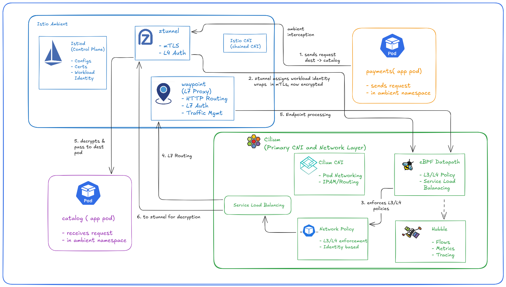
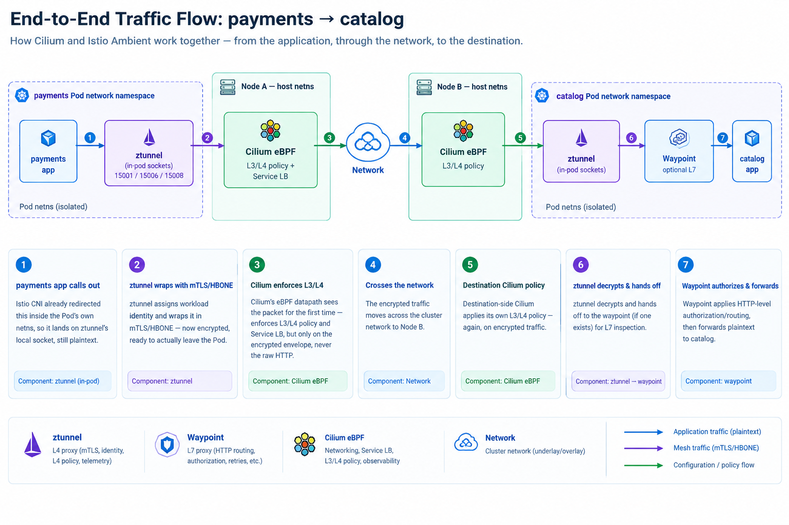

+++
title = "Who Owns the Traffic? Cilium, Istio, and the Line Between Them"
date = 2026-09-20
[taxonomies]
tags = ["cilium","istio","cni"]
[extra]
mermaid = true
+++

There's a point in every Kubernetes journey where "networking" stops meaning "get packets from Pod A to Pod B."

The applications start multiplying.

A simple Kubernetes cluster becomes a collection of services:

```text
frontend
   |
   +----> api
   |        |
   |        +----> payments
   |        |
   |        +----> catalog
   |
   +----> authentication
```

And the questions change:

- Who is actually calling `api`?
- Is that connection encrypted?
- Can this workload hit `/admin`?
- Should this request retry?
- Should an unhealthy backend get pulled?
- Which version should this request land on?
- Can I see network flow and application request separately?

This is where Kubernetes networking and service mesh start to overlap. And it gets genuinely interesting when the network is **Cilium** and the mesh is **Istio Ambient**.

On paper, running both sounds redundant — Cilium already does networking, LB, policy, observability, encryption, even service-mesh features. Istio already does identity, mTLS, authorization, traffic management, observability.

So why both? Not because either has more features. Because:

> **They can operate at different layers of the traffic path.**

Cilium owns the Kubernetes network and the L3/L4 datapath. Istio Ambient owns service identity, mesh security, and application-level behavior. Once that clicks, the architecture stops being mysterious.

### Cilium starts with the network

Cilium is fundamentally a networking and security platform built on eBPF. When a Pod comes up, Cilium is what makes it part of the network:

```text
                 Kubernetes
                     |
                     v
                Cilium CNI
                     |
          +----------+----------+
          |                     |
       Pod network          eBPF datapath
          |                     |
          |                L3/L4 processing
          |                Service LB
          |                NetworkPolicy
          |                Observability
          |
          v
       Pod
```

Big architectural difference from a traditional mesh: Cilium doesn't start with an application proxy. It starts in the kernel. eBPF gives it visibility and control without a sidecar next to every app, and it can still reach up into L7 when needed.

Which means this is a perfectly valid architecture on its own:

```text
Application
     |
     v
Cilium
     |
     +-- networking
     +-- Service load balancing
     +-- L3/L4 policy
     +-- observability
     |
     v
Application
```

For a lot of environments, that's enough. But distributed systems eventually create requirements that aren't networking problems anymore.

### Then there's Istio

A mesh exists so application teams don't each reinvent:

```text
TLS
authentication
service identity
authorization
timeouts
retries
traffic shifting
circuit breaking
request telemetry
```

Istio has traditionally done this with an Envoy sidecar next to every workload. Ambient throws that model out.

```text
                 Istio Ambient

              +----------------+
              |    Waypoint    |
              |      L7        |
              +-------+--------+
                      |
              +-------v--------+
              |    ztunnel     |
              |      L4        |
              |    mTLS        |
              +-------+--------+
                      |
                Kubernetes
                  network
```

**ztunnel** = the L4 layer, one per node. **waypoint** = optional L7 layer, added only when needed.

Instead of `1 Pod = 1 Envoy`, common L4 work moves to a shared, node-local proxy:

```text
Many Pods
    |
    v
 node-local ztunnel
```

L7 becomes an explicit, opt-in layer — not a default tax.

### Why a service mesh at all?

Cilium answers: **can these two workloads talk over the network?**

A mesh answers something sharper: **should this authenticated workload make this specific request?**

```text
payments  --->  catalog
```

At the network layer: `ALLOW payments → catalog TCP/8080`. Fine. But catalog exposes:

```text
GET  /products
GET  /admin
POST /checkout
DELETE /inventory
```

What you actually want:

```text
payments → GET /products      ALLOW
payments → GET /admin        DENY
payments → POST /checkout    ALLOW
```

The question shifts from "can payments connect to catalog" to "what is payments allowed to _do_ once it's there." The unit of decision changes:

```text
IP + port
```

becomes:

```text
workload identity + service + request
```

Everything below builds on that shift.

### But doesn't Cilium already have a service mesh?

Yes — and this is where the conversation gets oversimplified. Cilium genuinely does L7-aware traffic handling, mesh-style traffic management, security, observability, identity.

So it's **not** "Cilium can't do mesh." It's:

> **What kind of service-mesh architecture do we want — and which functionality do we want Cilium to own vs. Istio?**

Both can run sidecar-free. Both can use Envoy for L7. Both do identity-based security and encryption. But they start from opposite ends.

Cilium's path:

```text
eBPF
  |
  v
networking
  |
  v
L3/L4
  |
  v
L7 where needed
```

Istio's path:

```text
service identity
      |
      v
secure service communication
      |
      v
L4 mesh
      |
      v
L7 service behavior
```

Not two implementations of the same thing — two different ways of building the infrastructure around service communication.

### So why Istio for the mesh layer?

Not because Cilium's networking is weak. This is about the maturity of specific _mesh_ features.

Cilium's own [docs](https://docs.cilium.io/en/latest/network/servicemesh/mutual-authentication/mutual-authentication/) mark **Mutual Authentication as Beta**, call it incomplete, and list open roadmap items. More telling — the upgrade docs say it's actually **deprecated**, with users pointed to Ztunnel Transparent Encryption instead.

Doesn't mean Cilium is unfit for production. It means:

> I'm not building an architecture's security model on a feature whose lifecycle is still moving.

There's also a gap between Cilium's native L7 policy and its deeper Envoy customization — the advanced stuff runs through `CiliumEnvoyConfig` / `CiliumClusterwideEnvoyConfig`, which Cilium's own docs describe as implementation details with **minimal validation and no defined conflict resolution**. Workable, but now you're operating Envoy internals instead of declaring "allow this identity to call this service."

Istio's abstraction:

```text
Service identity
        |
        v
AuthorizationPolicy
        |
        v
Waypoint
        |
        +-- HTTP routing
        +-- authorization
        +-- retries
        +-- timeouts
        +-- traffic management
```

That's the actual reason for the split: Cilium = network, Istio Ambient = mesh. Not because Cilium can't — because the separation is cleaner.

### Istio's CNI

If Cilium is already the CNI, how does Istio have one too?

**Istio CNI isn't replacing Cilium.**

```text
                 Pod creation
                     |
             +-------+-------+
             |               |
             v               v
       Cilium CNI       Istio CNI
             |               |
     "give Pod network"  "connect Pod
             |            to Ambient"
             |               |
             +-------+-------+
                     |
                     v
                    Pod
```

Istio CNI is documented as a **chained plugin** — layered on the primary CNI, not competing with it. Required in Ambient mode.

Not this:

```text
Cilium CNI
       VS
Istio CNI
```

This:

```text
Cilium CNI
    +
Istio CNI
```

Mental model: **Cilium connects the Pod to Kubernetes. Istio CNI connects the Pod's traffic to the mesh.**

### Following an actual request

```text
payments application
        |
        v
   network traffic
        |
        v
   Cilium datapath
        |
        v
   Ambient interception
        |
        v
      ztunnel
        |
        v
   encrypted traffic
        |
        v
 destination ztunnel
        |
        v
 catalog application
```

The application has no idea any of this exists.

Cilium doesn't leave the picture — it still owns networking and the eBPF datapath, still enforces L3/L4 policy:

```text
                  Traffic
                     |
                     v
             +---------------+
             |    Cilium     |
             | Network       |
             | L3/L4         |
             | Service LB    |
             | NetworkPolicy |
             +-------+-------+
                     |
                     v
             +---------------+
             |    Istio      |
             | identity      |
             | mTLS          |
             | mesh          |
             +-------+-------+
                     |
                     v
             +---------------+
             |   Waypoint    |
             |   optional    |
             | L7            |
             +---------------+
```

**Istio CNI's job** happens before ztunnel: interception. A node-local DaemonSet configures the Pod so mesh traffic gets redirected into Ambient:

```text
                  Application Pod
                         |
                    normal traffic
                         |
                         v
                   Istio CNI
                         |
                 redirection
                         |
                         v
                     ztunnel
```

No Envoy sidecar inside the app Pod. Traffic enters the node-level Ambient plane instead. That's Ambient's defining trait.

**ztunnel = the L4 layer.** One per node, serving every workload on it. Handles identity, mTLS, L4 authorization, L4 telemetry, secure transport. istiod supplies its config and certs.


flowchart LR
    A["payments Pod"]
    C["Cilium eBPF"]
    Z1["source ztunnel"]
    H["HBONE + mTLS"]
    Z2["destination ztunnel"]
    D["catalog Pod"]

    A --> C
    C --> Z1
    Z1 --> H
    H --> Z2
    Z2 --> D


### Where mTLS actually kicks in

App sends `GET /products`, thinks it's just HTTP. Once Ambient has it, the hop is secured via mTLS over HBONE (HTTP/2 + HTTP CONNECT + mTLS). All inbound/outbound L4 TCP traffic in the mesh is secured this way, backed by workload X.509 identities.

```text
Application request

GET /products
      |
      v
   ztunnel
      |
      v
  mTLS / HBONE
      |
      v
   network
```

The boundary that matters: **Cilium sees the flow. It cannot read what's inside the encrypted mesh connection.**

# What happens when there is no waypoint?

Suppose the application only requires:

```text
mTLS
workload identity
L4 authorization
secure transport
```

Then the path can remain:


flowchart LR
    A["payments"]
    Z1["ztunnel"]
    N["Cluster Network"]
    Z2["ztunnel"]
    B["catalog"]

    A --> Z1
    Z1 -->|"mTLS / HBONE"| N
    N --> Z2
    Z2 --> B


There is no reason to introduce an L7 proxy just because the workload needs mTLS.

This is one of the most compelling ideas in Ambient:

> **Use an L4 proxy for L4 requirements. Add L7 infrastructure only where L7 is actually needed.**

Istio explicitly describes this as a progressive model, from no mesh, to secure L4 overlay, to full L7 processing.

# What changes when a waypoint exists?

Now suppose the application needs:

```text
HTTP authorization
HTTP routing
request-level telemetry
traffic management
```

The path changes:


flowchart LR
    A["payments Pod"]
    Z1["source ztunnel"]
    W["Istio Waypoint<br/>Envoy"]
    Z2["destination ztunnel"]
    B["catalog Pod"]

    A --> Z1
    Z1 -->|"HBONE"| W
    W -->|"L7 processing"| Z2
    Z2 --> B


The waypoint becomes the L7 decision point.

It can evaluate things like:

```text
HTTP method
HTTP path
headers
request identity
destination service
routing rules
authorization policy
```

Istio's current Ambient data-plane documentation describes the waypoint as the place where L7 policies such as `AuthorizationPolicy`, request authentication, telemetry, and L7 routing are applied.

So the architecture becomes:

```text
Cilium
  |
  | network
  v
ztunnel
  |
  | secure L4
  v
waypoint
  |
  | application-aware
  v
destination
```

# This creates a very useful division of labor

We can now assign ownership.

|Concern|Component|
|---|---|
|Pod networking|Cilium CNI|
|eBPF datapath|Cilium|
|Kubernetes Service load balancing|Cilium|
|Network policy|Cilium|
|Network observability|Cilium / Hubble|
|Ambient traffic interception|Istio CNI|
|L4 mesh|ztunnel|
|Workload mTLS|ztunnel|
|Workload identity|Istio|
|L4 mesh authorization|ztunnel|
|L7 authorization|waypoint|
|HTTP routing|waypoint|
|L7 traffic management|waypoint|

This is a much better way to understand the stack than simply saying:

> "Cilium is the CNI and Istio is the service mesh."

Those labels are technically correct but hide what actually happens to the traffic.

## The first important traffic example: Cilium only

Start without the mesh.


flowchart LR
    A["payments Pod"]
    C1["Cilium eBPF"]
    N["Network"]
    C2["Cilium eBPF"]
    B["catalog Pod"]

    A --> C1
    C1 --> N
    N --> C2
    C2 --> B


Cilium handles the networking.

There is no ztunnel.

There is no waypoint.

There is no service-mesh encryption.

This is the baseline.

## The second traffic example: Ambient L4

Now put both workloads into Ambient.


flowchart LR
    A["payments Pod"]
    C1["Cilium"]
    Z1["ztunnel"]
    H["HBONE + mTLS"]
    Z2["ztunnel"]
    C2["Cilium"]
    B["catalog Pod"]

    A --> C1
    C1 --> Z1
    Z1 --> H
    H --> Z2
    Z2 --> C2
    C2 --> B


Now the application gets:

```text
workload identity
+
mTLS
+
L4 mesh policy
```

without putting an Envoy sidecar inside the application Pod.

## The third traffic example: Ambient + L7

Now introduce the waypoint.


flowchart LR
    A["payments Pod"]
    C["Cilium"]
    Z1["ztunnel"]
    W["Waypoint"]
    Z2["ztunnel"]
    B["catalog Pod"]

    A --> C
    C --> Z1
    Z1 -->|"HBONE"| W
    W -->|"HTTP / L7 policy"| Z2
    Z2 --> C
    C --> B


Now the traffic can be controlled at two levels:

```text
Cilium
    |
    | L3/L4
    v
Istio
    |
    | L7
    v
Application
```

This is where the combination becomes interesting.

## The fourth traffic example: Cilium denies the connection

Imagine the network policy says:

```text
payments → database
DENY
```

The decision happens before the request has any reason to reach the application.


flowchart LR
    A["payments"]
    C["Cilium eBPF"]
    X["DROP"]

    A --> C
    C -->|"DENY"| X


Istio does not replace that network boundary.

Cilium remains the layer that protects the network.

## The fifth traffic example: Cilium allows, Istio denies

Now imagine:

```text
payments → catalog
TCP/8080
```

is allowed by Cilium.

But the HTTP request is:

```text
GET /admin
```

and the waypoint's authorization policy does not permit it.


flowchart LR
    A["payments"]
    C["Cilium<br/>L3/L4 ALLOW"]
    Z["ztunnel"]
    W["Waypoint"]
    X["L7 DENY"]

    A --> C
    C --> Z
    Z --> W
    W --> X


This is the layered security model:

```text
Cilium:
    Can the connection exist?

Istio:
    What is this workload allowed to do?
```

## The sixth traffic example: where things go wrong

Now ask Cilium to perform L7 HTTP enforcement on the same traffic that Istio Ambient is protecting.

The application sends:

```text
GET /products
```

Istio's side of the architecture says:

```text
encrypt the service-to-service traffic
```

Cilium's L7 layer says:

```text
I need to inspect the HTTP request
```

Now there is a fundamental conflict.


flowchart LR
    A["Application"]
    Z["Istio ztunnel"]
    E["mTLS / HBONE"]
    C["Cilium L7"]

    A --> Z
    Z --> E
    E --> C

    C -.->|"Cannot inspect original HTTP"| X["L7 ownership conflict"]


This isn't a theoretical concern.

Cilium's own Istio integration documentation demonstrates the interaction between Ambient mTLS and Cilium L7 policy and warns about the resulting conflict when Cilium's HTTP proxy is used on Ambient-managed traffic.

The lesson is not:

> "Cilium L7 is bad."

And it is not:

> "Istio L7 is better."

The lesson is:

> **Don't give two independent proxy systems ownership of the same encrypted L7 traffic path.**

Pick an owner.

# Two clean designs

**Cilium owns L7:**

```text
Application → Cilium → Cilium L7/Envoy → Network
```

**Istio owns L7:**

```text
Application → Cilium → ztunnel → Waypoint → Destination
```

Either works. Mixing them is where it breaks.

# Don't forget the Service itself

Apps call `catalog.default.svc.cluster.local`, not a Pod IP. With kube-proxy replacement, that LB runs in Cilium's eBPF datapath:


flowchart LR
    A["payments"]
    S["catalog Service"]
    C["Cilium eBPF Service LB"]
    B1["catalog-1"]
    B2["catalog-2"]
    B3["catalog-3"]

    A --> S
    S --> C
    C --> B1
    C --> B2
    C --> B3


Kubernetes Service LB (network layer) is a different thing from Istio's application-aware traffic management (waypoint can do HTTPRoute-driven L7 LB too). Question isn't "which supports LB" — both do. It's **which layer should make the decision.**

# The detail that actually bites people

Cilium's kube-proxy replacement is architecturally nice — one less component. But its socket-level LB can collide with Istio's interception.

Cilium's Istio integration docs recommend:

```text
kubeProxyReplacement = true
socketLB.hostNamespaceOnly = true
cni.exclusive = false
```

Stops Cilium's socket LB from stepping on Istio's proxying, lets it coexist with another CNI in the chain.

> Even when Cilium and Istio own different layers, their implementations still meet at the traffic-interception boundary. That boundary has to be designed on purpose.

# Where the encryption actually lives


sequenceDiagram
    participant P as Payments
    participant Z1 as Source ztunnel
    participant N as Network
    participant Z2 as Destination ztunnel
    participant C as Catalog

    P->>Z1: Application traffic
    Z1->>Z1: Workload identity
    Z1->>Z1: mTLS / HBONE
    Z1->>N: Encrypted traffic
    N->>Z2: Encrypted traffic
    Z2->>Z2: Authenticate / decrypt
    Z2->>C: Application traffic


We tend to draw it as "ztunnel to ztunnel," but the HBONE tunnel is really an encrypted channel between **source and destination workloads** — ztunnel is the machinery, not the trust endpoint. Even same-node traffic traverses Ambient, so L4 policy and telemetry stay consistent regardless of scheduling.

# The control plane, briefly

```text
                    istiod
                     |
          +----------+----------+
          |                     |
          v                     v
      ztunnel A             ztunnel B
          |                     |
       workloads             workloads
```

istiod talks to every ztunnel over xDS, hands out config and certs. No more per-Pod Envoy config to manage — common L4 lives in shared node-level ztunnels, L7 complexity is opt-in via waypoints. That's Ambient's whole idea, compressed.

# The full picture


Single Node data Flow


Multi Node Data flow *(image made with AI)*

Cilium isn't "the mesh." Istio isn't "the CNI." Istio CNI isn't competing with Cilium CNI. ztunnel isn't replacing the eBPF datapath. The waypoint isn't mandatory. Cilium's L7 and Istio's L7 should never fight over the same traffic.

# Why bother

Because distributed systems are messy, and the alternative is pushing TLS, certs, identity, retries, timeouts, authorization, routing, telemetry, and failure handling into every application team — implemented slightly differently every time.

A mesh standardizes that. But it's not free — now you have control planes, proxies, certs, interception, policies, routes, and a new debugging layer.

So the real question was never "can I run Cilium and Istio together." Obviously yes.

> **What complexity am I buying, and what complexity am I removing?**

Cilium: eBPF, networking, Service LB, L3/L4 policy, observability. Istio Ambient adds: identity, mTLS, L4 mesh, L7 authorization, traffic management — adopted incrementally. Need encrypted service-to-service? ztunnel. Need app-aware policy? Add a waypoint.

# The real reason to combine them

Not feature count. **Separation of concerns.**

```text
                         Application
                              |
                              v
                     +----------------+
                     |    Waypoint    |
                     |      L7        |
                     | authorization  |
                     | routing        |
                     | resiliency     |
                     +-------+--------+
                             |
                             v
                     +---------------+
                     |    ztunnel    |
                     |      L4       |
                     |     mTLS      |
                     |    identity   |
                     +-------+-------+
                             |
                             v
                     +---------------+
                     |    Cilium     |
                     | eBPF          |
                     | Networking    |
                     | Service LB    |
                     | L3/L4 policy  |
                     | Hubble        |
                     +-------+-------+
                             |
                             v
                      Kubernetes
                       network
```

- **Cilium** → can this traffic exist on the network?
- **ztunnel** → who is this workload, is the connection authenticated and encrypted?
- **waypoint** → what is this workload allowed to do at the application level?

# One rule to keep

> **Don't let two systems own the same traffic layer accidentally.**

```text
Cilium
  ↓
network

Istio Ambient
  ↓
service mesh

Waypoint
  ↓
L7
```

Problems start when it becomes Cilium L7 + Istio L7 + Istio mTLS all making independent calls on the same request. Fix isn't necessarily removing one — it's defining ownership and sticking to it.

# Closing thought

Both projects are converging on the same destination from opposite directions. Cilium started in eBPF networking and climbed up into application-aware security. Istio started with sidecars and is moving down into node-level L4 infra via Ambient. Cilium is even experimenting with its own ztunnel-style transparent encryption (still Beta) — another sign these two worlds are getting closer.

So the interesting question is no longer **Cilium or Istio.**

It's: **at which layer should each system stop, and where should the next one take over?**

Get that answer right, and the architecture stops being mysterious — and gets a lot easier to run.

And yeah, if you wanna do it yourself and check some other findings, check the github [repo](https://github.com/aadityapageni/istio-cilium-coherence.git)